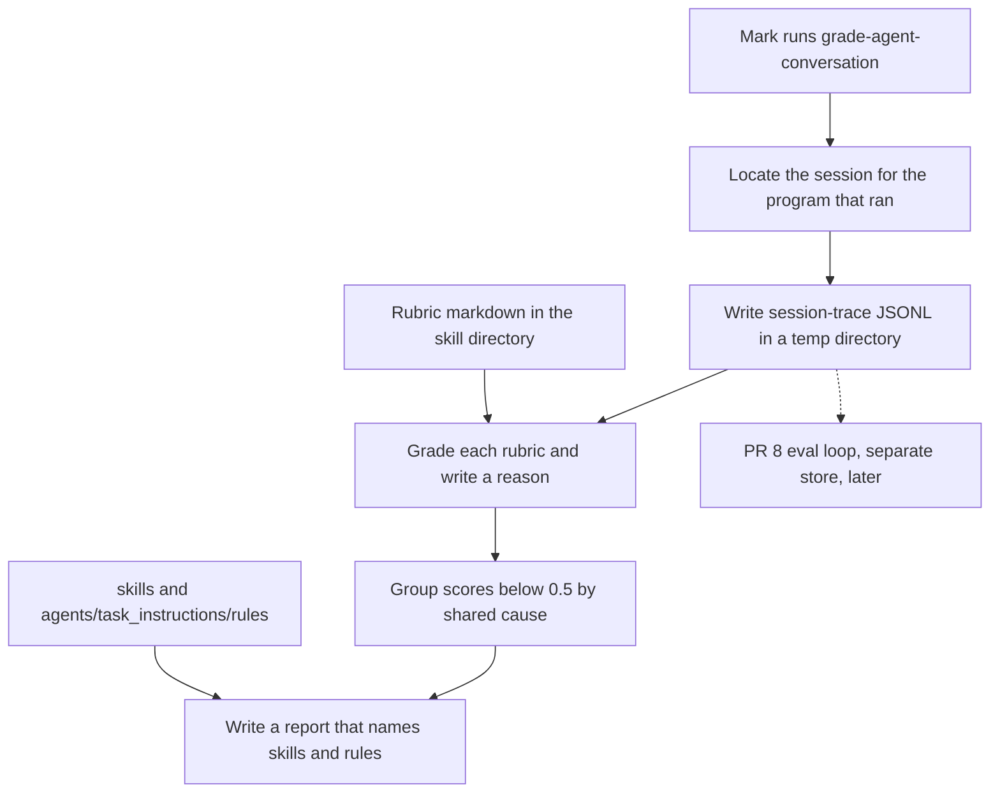

# Proposal: Grade coding-agent conversations against rubrics, then point the failures at skills

Scope: Chat request on 2026-10-19, no GitHub issue. The proposal covers how an agent finds a finished coding-agent conversation, writes it as one session trace, grades that trace on rubrics, groups the failures, and proposes edits to files in this repo. Commands, tests, and a collector script wait for `/create-implementation-plan`. The skills evals loop in [PR #8](https://github.com/mark-torres10/ai_tools/pull/8) stays a separate design. A session trace from this proposal can later be an input to that loop, and this proposal does not add `evals/`, hidden tests, or a judge agreement bar.

A session is one conversation with a coding agent. A session trace is the normalized JSONL file this proposal defines, schema `session-trace/0.1`. A rubric is a markdown file that names labels and scores for one quality, such as efficiency. A grade is one label, one score, and a short reason for one rubric on one session. A failure is a grade whose score is below 0.5, which is decision 2. A failure group is a set of failures that share a cause, such as "the agent wrote unit tests where the rule asks for end-to-end tests."

## Problem motivation

Mark runs Claude Code, Cursor, and Codex, and the useful record of that work is the conversation, including the tool calls, the file edits, and the time and tokens the run spent. Today those records sit in a different file, in a different shape, for each program. A session that felt slow, or that ignored a skill, has no grade Mark can compare with the next session.

Ben Holmes, DevEx lead at Warp, described the missing loop at AI Engineer New York on 10 October 2026, and again in an X post on 19 October 2026, [https://x.com/BHolmesDev/status/2112167234361839890](https://x.com/BHolmesDev/status/2112167234361839890). The attached video `bholmes_grading.mp4` (99 seconds) was transcribed for this proposal. The X page itself was not fetched, so the post text past the truncation in the request is not a source here. The rest of the pipeline is in Holmes's Warp post of 15 October 2026, [The road to self-improving software](https://www.warp.dev/blog/self-improving-software-proactive-agents), and in Warp's public `skill-doctor` skill, [SKILL.md](https://github.com/warpdotdev/common-skills/blob/main/.agents/skills/skill-doctor/SKILL.md).

On the whiteboard in the video, the pipeline is four boxes. Review the local session, score it, group the failures, and propose an improvement. The session box lists local agents, a session id, Warp's conversation storage, and a transcript of tool calls, MCP calls, and code outputs. The score box lists redundant tests, verbosity, and efficiency. Holmes drags `update-auth-service.jsonl` under three rubric files and marks redundant tests as fail, verbosity as pass, and efficiency as fail. The group box names one cause, "Routing: when to use e2e tests." He says the usual trigger is a merged pull request, and that each grade includes a written reason another agent can use when it proposes a change. The efficiency rubric on screen uses four labels, from `highly_efficient` at 1 to `highly_inefficient` at 0.2, and a pass is a score that stays above the line he set.

The Warp post states the same loop in four steps. Collect traces, tool calls, and artifacts. Score each session with rubrics, by a model or by a static check. Review the low-scoring sessions for a shared cause. Propose a change to the code, to a skill, or to `AGENTS.md`. `skill-doctor` is a working version of that loop for local transcripts. It scores efficiency, code quality, procedure compliance, and verbosity, treats a raw score below 0.5 as a failure, and drafts a skill diff without editing the real skill file. Each suggestion has to cite the failed session.

What Mark wants from that loop is narrower, and it is tied to this repo. The grader has to read the programs he already uses, write one trace shape, and send the feedback back to `skills/` and `agents/task_instructions/rules/`. A low efficiency score should be able to name the skill the agent should have read, say whether the transcript shows that read, and propose an edit. The skills evals proposal can later use the same traces as session logs. It answers a different question, which is whether a skill changes the result on a hidden test.

## High-level setup

The first version is a slash skill, `skills/grade-agent-conversation/`. Mark runs it at the end of a conversation, or he points it at a recent session. The agent that runs the skill locates the session for the program that produced it, writes `session-trace/0.1` JSONL into a temporary directory, grades that file against the rubric markdown, groups the grades below 0.5, and writes a markdown report in the same temporary directory. The report names the relevant skill or rule in this repo, says whether the transcript shows that the agent followed it, and includes a proposed edit. The skill does not edit `skills/` or `agents/` unless Mark asks it to apply a specific diff.

Holmes triggers the grader when a pull request merges, and Warp also runs a weekly pass over low scores. A merge hook that works the same way for Claude Code, Cursor, and Codex does not exist in this repo, so the slash skill is the trigger this proposal ships. Decision 1 keeps a later hook out of the first version.

The grader is the same kind of agent that did the work, reading a trace and a rubric. It is a model judge, which is the method Holmes describes, and it is not a second annotator with an agreement bar. [PR #8](https://github.com/mark-torres10/ai_tools/pull/8) is where a judge has to match Mark's labels before it scores unlabeled runs. Grades from this skill are notes on real sessions. They are not the adherence and effect scores in that proposal.



The dotted arrow means a later reader can load the JSONL into the eval loop. The skill does not write into `evals/`.

## How it works

### What already exists

`skills/suggest-rules-additions/SKILL.md` already asks an agent, at the end of a conversation, to infer preferences and propose additions to `docs/RULES.md`. It reads the live conversation, and it does not read a stored trace, a token count, or a tool result from disk. `skills/handoff/SKILL.md` writes an end-of-session summary, and it also stays inside the current context. `skills/review-rules/SKILL.md` reviews the current work against `agents/task_instructions/rules/`. None of those skills opens a Claude, Cursor, or Codex session file.

`skills/create-high-level-proposal/SKILL.md` is why this file lives under `docs/plans/`. The prototype skill in this change follows the front matter used by the other slash skills, including `disable-model-invocation: true`, so the agent runs it when Mark calls it.

The rules the feedback should be able to cite are the files under `agents/task_instructions/rules/`, which on 2026-10-19 are `CLEAN_CODE_PRINCIPLES.md`, `CODING_REPO_CONVENTIONS.md`, `RUN_SERVERS.md`, `UI_RULES.md`, and `router.md`. Skills are indexed in `skills/README.md`. Repo-wide instructions for agents are in `AGENTS.md` and `conventions/`.

### Extraction per tool

Each program below writes a session for its own resume feature. None of them documents the on-disk JSON as a stable export, except where a public API or a documented CLI flag says otherwise. The skill reads the files anyway, records the program version when the file has one, and leaves a field null when the source does not have it. A later release can move a field, so the implementation plan should pin the versions it was tried on.

The table is what a grader can recover. "Yes" means the source normally contains the field. "Partial" means the field is present only on some sessions, only in a second store, or only if someone captured it at the time. "No" means the documented object does not include it.

| Data | Claude Code | Cursor IDE | Cursor CLI | Codex CLI | Cursor Cloud |
| --- | --- | --- | --- | --- | --- |
| Messages | Yes, JSONL | Yes, JSONL | Yes, JSONL and `store.db` | Yes, rollout JSONL | Yes, text only on the durable API |
| Reasoning | Yes, `thinking` blocks when the model returns them | Partial, often `[REDACTED]` | Partial, suppressed in print output, present in `store.db` per a third-party reader | Partial, `reasoning` items, and the text is sometimes omitted | Partial, `thinking` events on the live stream only |
| Tool calls | Yes, `tool_use` | Yes, inputs | Yes, inputs and results | Yes, `function_call` and shell calls | Partial, live stream only |
| Tool results | Yes, `tool_result` | No, omitted on purpose | Yes, in `stream-json` and in `store.db` | Yes, `function_call_output` | Partial, live stream, and large results are dropped |
| File edits | Yes, inside Edit and Write inputs | Partial, inputs only | Yes, `writeToolCall` and edit args | Yes, inside patch and tool arguments | Partial, live stream if the args are not truncated |
| Timing | Yes, per event | Partial, often missing | Partial, run duration, and some event times | Yes, per event | Yes, run start, end, and `durationMs` |
| Model | Yes, `message.model` | Not in the documented transcript | Yes, on the CLI init event | Partial, provider on the header, model on `turn_context` when present | Not in the documented run object |
| Tokens | Yes, `message.usage` | No | No in the documented CLI result | Yes, `token_count` events | Yes, `GET /v1/agents/{id}/usage` |
| Dollar cost | No documented field | No | No | No | No |

#### Claude Code

Claude Code stores one append-only JSONL file per session at `~/.claude/projects/<encoded-cwd>/<session-id>.jsonl`. The encoded directory is the working directory with non-alphanumeric characters replaced by `-`, and a path longer than 200 characters is truncated and hashed. `CLAUDE_CONFIG_DIR` moves the root. The official sessions page, [Manage sessions](https://code.claude.com/docs/en/sessions), says the line format is internal and changes between versions, and it tells scripts to prefer `/export` or the script interfaces. `/export` writes a readable transcript. `claude --resume <session-id>` reopens a session. `--no-session-persistence` skips the file for one non-interactive run.

The field list below is the shape repeated by readers such as [claude-dev.tools](https://claude-dev.tools/docs/jsonl-format) and the toolpath notes on [tool calls](https://github.com/empathic/toolpath/blob/main/docs/agents/formats/claude-code/tools.md). Those writeups agree with each other. Anthropic's sessions page does not promise the fields. Each line has `type`, `uuid`, `parentUuid`, `timestamp`, `sessionId`, `cwd`, `gitBranch`, and `version`. A `user` line holds the prompt, or a `tool_result` whose `tool_use_id` matches an earlier call. An `assistant` line holds `message.content` blocks of `text`, `thinking`, and `tool_use`. The same line holds `message.usage`, with `input_tokens`, `output_tokens`, `cache_creation_input_tokens`, and `cache_read_input_tokens`, and it holds `message.model`. Some tool results also carry a top-level `toolUseResult` object. File edits are the `input` of `Edit` and `Write` calls. Subagent transcripts sit in a directory named for the session id, next to the session file. Dollar cost is absent from the documented fields. Tools that print a dollar figure compute it from the token counts and a price table, so this proposal writes `cost_usd` as null.

#### Cursor on the local machine

Cursor keeps the IDE conversation and the Agent CLI conversation in different stores. A Cursor staff reply on the forum, 13 April 2026, says the JSONL under agent transcripts includes user messages, assistant text, and tool-call inputs, and that tool-call outputs are left out because they are large. The same reply says the model provider writes `[REDACTED]` on reasoning before Cursor stores the line. A later staff reply confirms that IDE chats and CLI chats still do not share a session id, and that passing an IDE transcript id to `cursor-agent --resume` does not load that IDE conversation. See [Accessing the Full Agent Transcript](https://forum.cursor.com/t/accessing-the-full-agent-transcript-in-cursor/157311) and [separate session stores](https://forum.cursor.com/t/local-ide-agent-chats-and-the-agent-cli-still-use-separate-session-stores/165486).

IDE transcript files are at `~/.cursor/projects/<workspace-slug>/agent-transcripts/<session-id>/<session-id>.jsonl`. On this cloud agent machine, during the run `bc-7b998e63-ca85-56cf-9323-f14f1bdc35a2`, `/workspace` maps to `~/.cursor/projects/workspace`, and that directory had no `agent-transcripts` folder and no session JSONL. A third-party reader, [deja-vu](https://vshulcz.github.io/deja-vu/registry/cursor.md), reports that transcript records often have no timestamp field, and that a user turn sometimes begins with a timestamp tag. The editor can also export a chat as Markdown, which keeps roles and text and drops tools, times, and the model. Older Composer state lives in SQLite `state.vscdb` under the Cursor user directory (`~/.config/Cursor/User/` on Linux, `~/Library/Application Support/Cursor/User/` on macOS), in `globalStorage` and in `workspaceStorage`. Cursor does not document that schema. Decision 4 leaves `state.vscdb` unread.

The Agent CLI is the path that has tool results. With `--print` and `--output-format stream-json`, the CLI emits NDJSON that the [output format](https://cursor.com/docs/cli/reference/output-format) page documents. The `system` init event has `model`, `cwd`, `session_id`, and `permissionMode`. `user` and `assistant` events carry message text. `tool_call` events come in `started` and `completed` pairs joined by `call_id`, and the completed event includes `result`. A write tool's arguments include `path` and `fileText`. The terminal `result` event has `duration_ms`, `duration_api_ms`, `session_id`, and the full assistant text. The same page says `thinking` events are suppressed in print mode, and the documented result object has no token counts and no dollar cost. Per-event `timestamp_ms` appears when `--stream-partial-output` is on, and some of those assistant events are duplicates the client is told to skip.

After the CLI exits, the session remains on disk. Staff replies name `~/.cursor/chats` and `~/.cursor/acp-sessions/.../store.db` as the CLI and ACP stores. Third-party readers put a CLI chat at `~/.cursor/chats/<hash-of-cwd>/<session-id>/store.db`, with a `meta.json` that holds `cwd`. They describe the SQLite blobs as message parts in the Vercel AI SDK shape, including `reasoning`, `tool-call`, and `tool-result`. The hash and the blob layout come from those readers. Cursor's docs do not describe them, so the skill treats `store.db` as a fallback and prefers a `stream-json` capture when Mark still has one. `cursor-history` ([S2thend/cursor-history](https://github.com/S2thend/cursor-history)) already walks the transcript JSONL, `store.db`, ACP `store.db`, and `state.vscdb` behind one CLI. Reusing that CLI is decision 8. The first version does not take the dependency, because the skill can read the JSONL and a captured `stream-json` file with no new package.

A `postToolUse` hook can append tool outputs that the IDE transcript omits. That hook records new sessions only. It does not fill in old transcripts.

#### Codex CLI

Codex calls a stored session a rollout. The files live under `$CODEX_HOME/sessions/YYYY/MM/DD/rollout-<timestamp>-<uuid>.jsonl`, and `$CODEX_HOME` defaults to `~/.codex`. The date is the local day the session started. Cold rollouts are compressed to `.jsonl.zst`, and a reader that only opens `.jsonl` misses them. `session_index.jsonl` at the Codex home is the index by session id. Archived sessions move to `archived_sessions/`. `[history] persistence = "none"` in `config.toml` stops the files, and `codex exec --ephemeral` skips one run. `/rollout` prints the current file path, and `/export` writes Markdown.

The line format is internal. On 12 May 2026, the GitHub user `etraut-openai` said so in [openai/codex#22354](https://github.com/openai/codex/issues/22354), and closed a request to rename the token fields for that reason. The shape below is what the Codex source writes. A line is `{ "timestamp", "type", "payload" }`. The first line is `session_meta`. The payload's `meta` includes the session id, `cwd`, `originator`, `cli_version`, `source`, and `model_provider`, plus an optional `git` object. Later `response_item` lines use the Responses API item types from `codex-rs/protocol/src/models.rs`, on the tag `rust-v0.63.0` and on current `main`. The types are `message`, `reasoning`, `function_call`, `function_call_output`, `custom_tool_call`, `local_shell_call`, and `web_search_call`. `function_call.arguments` is a JSON string. Reasoning items can carry `summary`, `content`, and `encrypted_content`. The serializer omits reasoning text in some cases, so a rollout can have a reasoning item with no readable text. `event_msg` lines of type `token_count` carry `total_token_usage` and `last_token_usage`. Each of those objects has `input_tokens`, `cached_input_tokens`, `output_tokens`, `reasoning_output_tokens`, and `total_tokens`, and the event also has `model_context_window`. `total_token_usage` is the session total, and `last_token_usage` is the latest turn. The model slug is on a `turn_context` line when that line is present. `session_meta` guarantees `model_provider`, and it does not guarantee the model slug. `token_count` has no dollar field. File edits are inside the tool arguments, often an apply-patch payload.

#### Cursor Cloud and background agents

Cloud agents do not leave a durable local transcript that another machine can read. On this run the VM had `~/.cursor/projects/workspace` and did not have a session JSONL, `~/.claude`, or `~/.codex`. The public way to read a finished cloud agent is the Cloud Agents API, documented at [endpoints](https://cursor.com/docs/cloud-agent/api/endpoints) and [v0](https://cursor.com/docs/cloud-agent/api/v0).

The legacy v0 call `GET /v0/agents/{id}/conversation` returns `{ id, messages: [{ id, type, text }] }` where `type` is `user_message` or `assistant_message`. That object is the user text and the assistant text. It has no tool calls, no tool results, no reasoning, no per-message time, and no tokens. A deleted agent returns no conversation. Message `id` values were regenerated on every read, which Cursor staff confirmed as a bug on 23 March 2026 ([forum thread](https://forum.cursor.com/t/get-v0-agents-id-conversation-returns-different-message-ids-for-identical-messages-across-repeated-reads/155649)). An internal "Reminder to commit and push if appropriate" user message has also appeared in that payload ([forum thread](https://forum.cursor.com/t/cloud-agent-sending-an-unexpected-reminder-to-commit-and-push-if-appropriate-message/153563)). The skill should drop that reminder if it is present, and it should identify messages by index plus a hash of the text until the ids are stable.

The current v1 API has no documented REST equivalent of that conversation endpoint. `GET /v1/agents/{id}/runs/{runId}` returns status, `createdAt`, `updatedAt`, and, once the run has finished, `durationMs`, the final assistant `result` text, and `git.branches[]` with `repoUrl`, `branch`, and `prUrl`. The `git` object is the agent's current pushed branches, and the docs say every run on the same agent returns the same git snapshot. A staff forum reply says the diff rollup, meaning files changed and lines added or removed, is not on this object. `GET /v1/agents/{id}/usage` returns per-run `inputTokens`, `outputTokens`, `cacheWriteTokens`, `cacheReadTokens`, and `totalTokens`. It does not return dollars. The documented Get An Agent and Get A Run fields do not include the model id. The model id is on the create request as `model.id`, so a caller who stored that request can fill it in, and a caller who did not has to leave the model null.

Tool calls, tool results, and reasoning for a cloud run are on the live SSE stream, `GET /v1/agents/{id}/runs/{runId}/stream`. Events include `assistant` text deltas, `thinking` text deltas, and `tool_call` objects with `callId`, `name`, `status`, `args`, `result`, and `truncated`. Public tool names in the docs include `read_file`, `run_terminal_cmd`, `edit_file`, and `mcp`. If `args` or `result` is too large, Cursor omits the field and sets `truncated`. The stream response sends `X-Cursor-Stream-Retention-Seconds`, and after that window the endpoint can return `410 stream_expired`. A finished run then has to be read from Get A Run, which does not contain the tool trace. So a full cloud trace exists only when something recorded the stream before it expired. The prototype grades a cloud session from the text conversation plus the usage and duration endpoints, and it sets `agent_trace.result_status` to `absent` on every tool row it does not have. A captured stream file, if Mark saved one, is the input that fills those rows.

A cloud agent also has an internal `cursor-cloud` tool, `batch-fetch-details`, that can write `transcript.json` for runs the caller is allowed to see. That tool is not the public API, and this proposal does not read it, because the file's fields are not published. The public contract is the API above.

### Trace format

Mark needs one file shape, so the grader and the eval loop can share a reader. Practitioners use two kinds of record for this data. A telemetry record is a span or an observation in a trace backend. An eval sample is a conversation plus a score.

| Format | What it is good at | Why it is not the file this skill writes |
| --- | --- | --- |
| OpenTelemetry GenAI semantic conventions, v1.37.0 | Vendor-neutral names for the operation, the provider, the model, the conversation id, token counts, and tool calls. Phoenix and Langfuse can ingest these spans. | The convention status is Development, so names can still move. A span is also the wrong container for a grader that wants one JSONL file next to a rubric. |
| OpenInference | Stable span kinds (`LLM`, `AGENT`, `TOOL`, `EVALUATOR`) and message attributes that Arize Phoenix reads directly. | The names are Arize's, and the coding agents here already write events, not OpenInference spans. |
| Langfuse observations and LangSmith runs | Product stores with a UI, a generation type, and token fields. Langfuse accepts OpenTelemetry. | A product schema would make the file depend on one vendor's export. |
| Inspect AI eval logs | An `EvalSample` with `messages`, `events`, `scores`, `model_usage`, and timing. `.eval` is the binary log, and `.json` is the same object as text. | A sample assumes a task, a target, and a scorer. A real coding session has none of those until someone grades it. |
| OpenAI chat messages | `role`, `content`, and `tool_calls`, which every grader already understands. | A chat list has no session header, no per-event time, no token counts, and no place to say that a tool result was missing. |

Use a thin JSONL file, schema `session-trace/0.1`. Where OpenTelemetry GenAI v1.37.0 already names a field, the file uses that name. Where it does not, the file uses an `agent_trace.*` key. The message body uses the same content blocks as an OpenAI or Anthropic chat message, so a grader can read the conversation without learning span attributes. The pin to v1.37.0 matters because that document's status is Development. The copied names are `gen_ai.conversation.id`, `gen_ai.operation.name`, `gen_ai.provider.name`, `gen_ai.request.model`, `gen_ai.response.model`, `gen_ai.usage.input_tokens`, `gen_ai.usage.output_tokens`, `gen_ai.tool.name`, `gen_ai.tool.call.id`, `gen_ai.tool.call.arguments`, and `gen_ai.tool.call.result`. `execute_tool` and `chat` are the operation names from that document. Cache tokens, reasoning tokens, dollar cost, file edits, and a missing-result flag stay under `agent_trace.*`. Those names are not settled in v1.37.0, so copying a guessed OpenTelemetry key would label a local field as if the convention had already defined it.

OpenInference is the file to write when the next step is to open the session in Phoenix. The next step here is a rubric grade and a skill edit. The same JSONL can be mapped onto OpenInference spans later, and the source file can keep these keys. Inspect is the file to write once a session has a task and a score. [PR #8](https://github.com/mark-torres10/ai_tools/pull/8) is that sample. A later adapter can build one `EvalSample` from one session trace plus the grade report. The adapter is out of this proposal.

One session is one JSONL file. The first line is the session header. Later lines are messages, tool calls, and usage. The skill writes null for a field the source does not have, and it does not drop the key, so a grader can tell "the agent made no tool call" from "the store omitted tool results."

```json
{"record_type":"session","schema":"session-trace/0.1","gen_ai.conversation.id":"3995c068-1e5e-4f0a-9c0a-0b1c2d3e4f5a","agent_trace.source":"claude_code","agent_trace.source_path":"/home/mark/.claude/projects/-Users-mark-ai-tools/3995c068-1e5e-4f0a-9c0a-0b1c2d3e4f5a.jsonl","agent_trace.cwd":"/Users/mark/ai_tools","agent_trace.git_branch":"main","agent_trace.harness_version":"2.1.85","gen_ai.provider.name":"anthropic","gen_ai.request.model":"claude-sonnet-4-5","agent_trace.started_at":"2026-10-19T18:04:11Z","agent_trace.cost_usd":null}
{"record_type":"message","gen_ai.operation.name":"chat","timestamp":"2026-10-19T18:04:12Z","role":"user","content":[{"type":"text","text":"Add a failing test before the fix."}]}
{"record_type":"message","gen_ai.operation.name":"chat","timestamp":"2026-10-19T18:04:20Z","role":"assistant","gen_ai.response.model":"claude-sonnet-4-5","content":[{"type":"thinking","text":"The skill says the test commit comes before the fix."},{"type":"text","text":"I'll add the test first."}]}
{"record_type":"tool_call","gen_ai.operation.name":"execute_tool","timestamp":"2026-10-19T18:04:21Z","gen_ai.tool.name":"Edit","gen_ai.tool.call.id":"toolu_01","gen_ai.tool.call.arguments":{"path":"tests/test_notes.py","old_string":"","new_string":"def test_missing_id():\n    ..."},"gen_ai.tool.call.result":"The file tests/test_notes.py has been updated.","agent_trace.result_status":"present","agent_trace.duration_ms":null,"agent_trace.file_edits":[{"path":"tests/test_notes.py","kind":"edit"}]}
{"record_type":"usage","timestamp":"2026-10-19T18:04:22Z","agent_trace.usage_scope":"turn","gen_ai.response.model":"claude-sonnet-4-5","gen_ai.usage.input_tokens":1200,"gen_ai.usage.output_tokens":80,"agent_trace.usage.cache_read_input_tokens":0,"agent_trace.usage.cache_creation_input_tokens":0,"agent_trace.usage.reasoning_output_tokens":null,"agent_trace.cost_usd":null}
```

`agent_trace.source` is `claude_code`, `cursor_ide`, `cursor_cli`, `codex_cli`, or `cursor_cloud`. `agent_trace.result_status` is `present`, `absent`, `truncated`, or `error`. `agent_trace.file_edits[].kind` is `write`, `edit`, or `delete`. `agent_trace.usage_scope` is `turn` or `session`. Codex's `total_token_usage` and `last_token_usage` are different sums, so the grader has to know which sum a usage line holds. For a cloud export that only has text, the agent still writes a session line and message lines. The usage line comes from `GET /v1/agents/{id}/usage`, with `usage_scope` set to `session`.

The example above is illustrative. The token counts and the session id are not a measured session from this repo.

### Skill flow

`skills/grade-agent-conversation/SKILL.md` is the prototype. It is slash-only. When Mark runs it, the agent does the following.

1. The agent decides which program produced the session. If Mark names a file, the agent uses that file. If he does not, the agent looks for the newest session whose `cwd` is this repo, in the store for the program that is running the skill.
2. The agent reads the source described in the extraction section and writes one `session-trace/0.1` file under `$TMPDIR/grade-agent-conversation-<id>/`. The agent does not commit that file, and it does not copy raw tool output into a pull request.
3. The agent reads the four rubric files in `skills/grade-agent-conversation/rubrics/`.
4. The agent grades the trace, groups the failures, and writes `report.md` in the same temporary directory.
5. The agent shows Mark the scores, the failure groups, and the path to `report.md`. It stops there. Applying a proposed skill edit is a separate request.

The prototype has no collector script. The agent does the read and the write, which is enough to check that the paths and the JSONL shape work on one real session. A script is worth adding only after that check fails because the files are too large or the formats drift. Decision 8 records the option to shell out to `cursor-history` instead of teaching the agent the Cursor paths.

### Grading

Each rubric file has a name, a one-sentence description, and a list of labels with a score and a description of when the label applies. The scores follow the scale on Holmes's efficiency slide. `1` and `0.8` are above the line, and `0.4` and `0.2` are below it. A grade stores the label, the numeric score, and one to three sentences that cite a tool call id, a file path, or a short quote from the trace. A rubric that does not apply stores `not_applicable` and no score. `not_applicable` does not make the session fail, which is the same rule `skill-doctor` uses for `insufficient_evidence`.

The four starting rubrics are in the prototype.

- **Verbosity.** The agent was direct, or it repeated itself, narrated every tool call, or left comments and summary the user did not ask for. Holmes's pass example was an agent that did not fill the diff with comments.
- **Efficiency.** The agent went to the result, or it reread the same files, retried a command, or explored a test setup the repo already documents. Holmes's fail example was an agent that explored the test environment because the instructions never said how to run the tests.
- **Test quality.** The tests the agent added match the rule for this repo, or they sit at the wrong layer, repeat another test, or assert nothing. Holmes's fail example was a pile of unit tests where the guideline prefers end-to-end tests. There is no hidden test suite here, so the grader judges the tests that appear in the diff and in the trace.
- **Skill adherence.** For each skill or rule that the task called for, the trace shows a read of that file and later actions that match it. A session where no file in this repo applied is `not_applicable`. A session where `skills/implement-from-spec/SKILL.md` applied, and the agent wrote the implementation before the failing test, fails this rubric.

The pass line is a raw score below 0.5. That line sits in the gap between 0.8 and 0.4 on the slide, and it is the line `skill-doctor` already uses. The report also stores the label, so Mark can change the line later without re-reading the trace. The skill does not curve the scores into a letter grade. Warp's curve (`0.5 + 0.5 * score`) is for a shareable scoreboard, and Mark does not need that board to decide on a skill edit.

Grouping happens after the grades. The agent clusters failing grades that share a cause, and it names the cluster the way the whiteboard did, with the area and the missing instruction. "Routing: when to use e2e tests" is the example from the talk. A group lists the session ids, the rubric, the score, and the reason. One session can sit in more than one group. The agent does not invent a group for a single vague complaint. A group needs at least one cited moment in a trace.

### Feedback

The report's last section is the part that ties the grade to this repo. For each failure group, the agent does four things.

- It names the existing file that should have covered the failure, with the path. Skills come from `skills/*/SKILL.md`, using the descriptions in `skills/README.md` as the index. Rules come from `agents/task_instructions/rules/`. Writing failures can also cite `conventions/vocabulary.md` and `conventions/clear_writing_principles_addy_osmani.md`. Repo-wide agent instructions cite `AGENTS.md`.
- It says whether the trace shows a read of that file. A read is a tool call whose path is that file. If the tool results are `absent`, the agent says the read cannot be confirmed, and it does not treat a missing result as proof the agent skipped the file.
- It says whether the later actions match the file. The reason cites the tool call or the edit that matches or breaks the instruction.
- It proposes an edit. For an existing file, the proposal is a unified diff that changes only the step the trace shows was missing or easy to skip. For a gap with no file, the proposal is a new `SKILL.md` outline or a new rule under `agents/task_instructions/rules/`. The diff is in the report. The skill does not write it into the repo unless Mark asks.

A suggestion that does not cite a failed grade is out. That constraint is from `skill-doctor`, and it is what keeps the report from turning into generic advice.

### File structure

```text
docs/plans/2026-10-19_agent_conversation_grading_8b4df5/
  proposal.md                         this file

skills/grade-agent-conversation/
  SKILL.md                            slash skill, prototype
  rubrics/verbosity.md                labels and scores
  rubrics/efficiency.md
  rubrics/test-quality.md
  rubrics/skill-adherence.md

skills/README.md                      one new row in the index
```

`agents/`, `conventions/`, and the other skills stay as they are. The temporary report directory is outside the repo. A later implementation plan can add a collector script under this skill if the by-hand export is too brittle. That script is not in this change.

### Schema and key interfaces

The rubric markdown in git is the source for the labels. The session trace and the report are files in a temp directory. They are files, and the skill does not insert them as database rows. The skill does not use SQLite. [PR #8](https://github.com/mark-torres10/ai_tools/pull/8) uses SQLite because that loop has a queue of unlabeled runs. The grading skill scores the sessions Mark points at, so a directory of JSONL plus one `report.md` is enough.

| Model | Lives in | Role |
| --- | --- | --- |
| `SessionTrace` | temp JSONL (new, not in git) | One normalized session. The line types are `session`, `message`, `tool_call`, and `usage`. |
| `Rubric` | `skills/grade-agent-conversation/rubrics/*.md` (new) | Labels, scores, and the text the grader reads. |
| `Grade` | `report.md` (new, not in git) | One label, one score or `not_applicable`, and a reason, for one rubric. |
| `FailureGroup` | `report.md` (new, not in git) | A cause, the grades that share it, and the proposed skill or rule edit. |

`SessionTrace` fields are the keys in the example record. Every key in that example is written on the lines where it applies. `cost_usd` is written and set to null when the source has no dollar field. The judge prompt is the rubric file plus the trace, and the prompt text is not stored.

### How this connects to the skills evals proposal

[PR #8](https://github.com/mark-torres10/ai_tools/pull/8), `docs/plans/2026-10-19_skills_evals_loop_c19a7e/proposal.md`, builds a controlled loop. Pi runs one skill on one task, the runner stores the Pi session JSONL, and scores come from log checks, from Mark, and from a judge that has to clear an agreement bar. Part 2 of that proposal, which is still a sketch, wants failure traces before it rewrites a `SKILL.md`.

A `session-trace/0.1` file can be that session artifact later, once a Pi export is mapped into the same keys. The rule grader in PR #8 looks for file reads, commit order, and token fields. In this schema, file reads and edits are `tool_call` lines, and token fields are `usage` lines, so the two designs can share a reader. Each proposal keeps its own store. A grade from a real Cursor session stays in the grading report. An adherence score on `notes_tag` stays in the eval loop. When Mark writes the next task or the next rubric line for that loop, the failure groups from this skill are a place to look. A failure group does not skip the agreement bar, and it does not enter the DSPy search.

The grading proposal does not create `evals/skills_loop/`. PR #8 does not have to wait for these traces.

## Expected results

When the first version is done, Mark has a proposal he can confirm before any collector exists, and a slash skill he can run on one real session. The skill writes one JSONL file and one `report.md` in a temp directory. The failure section of the report names a path under `skills/` or `agents/task_instructions/rules/`, or it says that no file in the repo covers the failure and proposes a new one.

No session count, token total, or dollar total is estimated here. The skill grades the sessions Mark points at, and the cost is whatever that grading conversation spends. The prototype does not batch a team's history the way `skill-doctor` does.

## Open questions

1. **What triggers the grader?** Recommendation: the slash skill only, run by Mark when a conversation ends or when he names a session. Reason: Claude Code, Cursor, and Codex do not share a merge webhook, and a hook that only some of them can fire would grade a biased subset. Alternative: also run on pull-request merge for whichever program can see the session id on the branch.

2. **Where is the pass line?** Recommendation: a raw score below 0.5 fails, and `not_applicable` does not fail. Reason: 0.5 sits between the 0.8 and 0.4 labels on the efficiency slide, and `skill-doctor` uses the same cutoff. Alternative: fail only `highly_inefficient`-style labels at 0.2, and treat 0.4 as a warning.

3. **Where do traces and reports go?** Recommendation: a temp directory, never git. Reason: tool results can contain the workspace and secrets, which is the same reason PR #8 leaves session files out of git. Alternative: a gitignored `grades/` directory in the repo so the files survive a reboot.

4. **Does the skill read Cursor's `state.vscdb`?** Recommendation: no. The agent reads `agent-transcripts` JSONL, a `stream-json` capture, and CLI `store.db` when the capture is missing. Reason: the SQLite schema is undocumented and has already moved between Composer generations. Alternative: read `state.vscdb` through `cursor-history` and accept the breakage when Cursor changes the keys.

5. **How complete does a Cursor Cloud grade have to be?** Recommendation: grade the v0 text plus v1 usage and duration now, mark every missing tool result as `absent`, and fill tool rows only from a stream file Mark already saved. Reason: the durable API does not return tool calls, and the stream expires. Alternative: skip cloud sessions until a durable tool trace exists.

6. **Does the skill estimate dollar cost?** Recommendation: write `cost_usd` as null unless a source field contains a dollar amount. Reason: none of the five sources documents a dollar field, and a price table would be a second dataset to keep current. Alternative: multiply the token counts by a price table checked into the skill.

7. **Are subagent transcripts in the first grade?** Recommendation: include Claude Code subagent JSONL when the parent session has that directory, and leave Cursor and Codex child agents out until one real parent session shows where those children are stored. Reason: Claude's layout is the one readers already agree on, and the other two are easier to get wrong. Alternative: grade the parent only, everywhere.

8. **Should the Cursor read shell out to `cursor-history`?** Recommendation: no in the prototype. The skill reads the JSONL paths directly. Reason: a new package is a dependency and a version to pin, and the first check only needs one session. Alternative: require `cursor-history` so IDE, CLI, and ACP stores share one reader.
