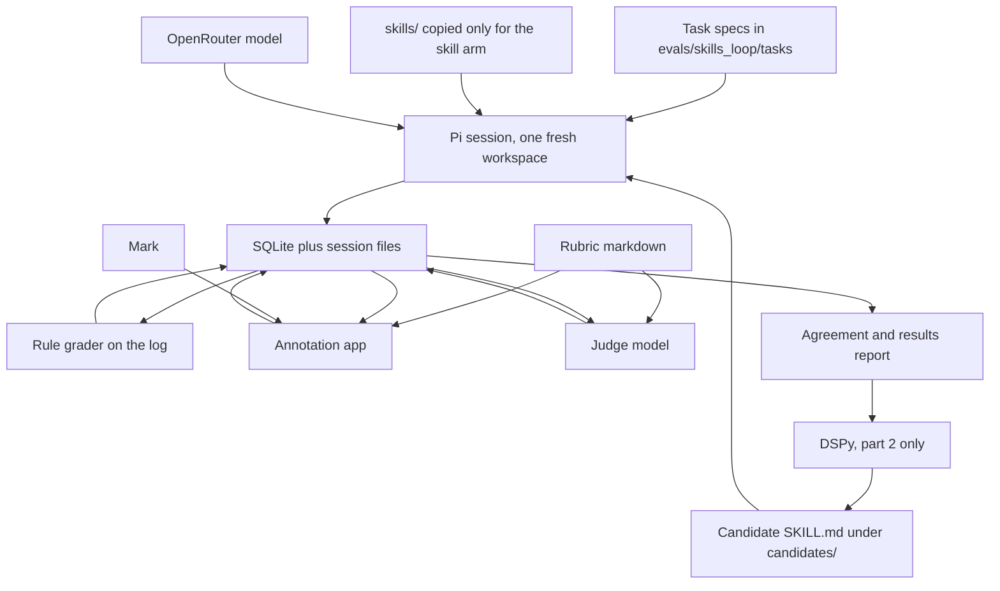
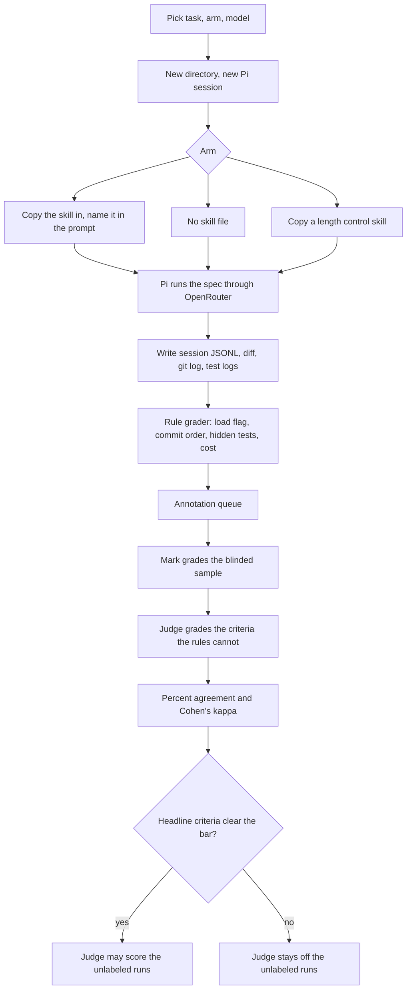

# Proposal: Evals loop for the skills in `skills/`

Scope: Chat request on 2026-10-19, no GitHub issue. The proposal covers how Mark measures the skills in `skills/`, and how he improves one skill after the measurement is confirmed. The proposal names the files, the records, and the choices. Commands, tests, and file-by-file edits wait for `/create-implementation-plan`. Part 2, the improvement phase, is a sketch, and part 2 doesn't start until Mark confirms the evaluation design.

The method comes from Sergii Makarevych, "How to write and test agent skills with evals", 19 Oct 2026, [https://x.com/sermakarevich/status/2112198653469241856](https://x.com/sermakarevich/status/2112198653469241856). Figures in this proposal that come from his article are his, and they aren't measurements from this repo.

An eval here is a repeatable run of one skill on one task, plus a score. Adherence means the agent did what the skill text says. Effect means the output is better on checks the agent didn't see. An arm is one condition in the comparison, such as no skill, the skill, or a length control of unrelated text at the same word count. The judge is a second model that scores the artifacts. A rubric is the list of criteria for one skill. Cohen's kappa is the agreement between two raters after you subtract the agreement that chance would produce.

## Problem motivation

`skills/` holds 31 skills, counted from `skills/*/SKILL.md` on 2026-10-19. No script in the repo runs one of the 31 skills on a task. No script keeps the transcript or scores the output. Mark's current read on a skill is a session that felt fine. Makarevych's article gives the reason to keep two scores, because a single outcome can't tell a bad wording from a bad idea. Either the agent didn't follow the text, or the agent followed the text and the result was no better.

The model question has the same gap. The skill files are instructions, and Makarevych reports that the same skill can gain on one model and lose on another. A score with no model id doesn't transfer to the next model. Mark wants to know how the skills he already wrote behave, and which models follow them when Pi calls the models through OpenRouter.

Pi is the agent program that reads a skill and calls a model ([pi.dev](https://pi.dev/docs/latest/quickstart)). OpenRouter is the service that exposes many models through one API. A harness is the program around the model, and here the harness is Pi. Today Mark accepts a skill because the file looks right. With the loop in place, he accepts a skill for a named model, for Pi, and for a date, and only when adherence is high and effect beats the comparison arms at a cost he accepts.

## The two-part setup

Part 1 is evaluation, and most of the proposal is about part 1. Mark runs a skill and a no skill baseline on the same tasks, across models, and he stores every transcript. Mark grades a sample in a local annotation app. A judge model grades the same artifacts against a rubric taken from the skill. Mark's labels decide whether the judge is trustworthy. Until the judge clears the bar in decision 6, the judge doesn't score runs Mark hasn't labeled.

Part 2 is improvement, and part 2 waits until Mark confirms part 1, including the agreement bar. DSPy is a library that rewrites an instruction file to raise a metric. In part 2, DSPy proposes a new `SKILL.md` for one skill, and the eval from part 1 is the metric. Mark discards a candidate that doesn't beat the current file on tasks held out of the search. Part 2 doesn't replace anything under `skills/` until Mark commits the candidate himself.

Mark writes the reading rule before the first full run, so he doesn't reinterpret the table afterward.

- If adherence is low, the wording failed on that model, and the idea is still untested.
- If adherence is high and effect is flat against the no skill arm, the agent obeyed, and the idea didn't help that model.
- If effect is up and the length control arm matches the skill arm, the extra tokens moved the result, and the ideas in the skill aren't supported yet.
- If effect is up against both the baseline and the length control, at a cost Mark accepts, he keeps the skill for that model and writes both numbers next to the file.

The two parts only work if the records, the graders, and the candidate files have one fixed path. The diagrams below are the path.

## Architecture



The annotation app and the judge both read the rubric and the artifacts. The judge doesn't read Mark's labels, and Mark doesn't see the judge's scores until his own grade is saved. The arrow from a candidate file back to Pi is part 2. Mark leaves the candidate path unused until he confirms the report.



Hidden tests run after the session, from files that were never in the workspace.

The diagrams name the parts. The sections below name the files, the fields, and the scores.

## How it works

### What already exists

The repo has no runner, no annotation app, and no eval store, so the loop is new. Part 1 reads the files below and doesn't edit them.

- `skills/implement-from-spec/` is the first skill under test. `SKILL.md` is 857 words when split on whitespace, counted on 2026-10-19. The directory also holds `checklist.md`, `references/`, and `examples/pipeline-memory-repo.md`, which is 722 words by the same count.
- `agents/personas/ai_engineering/domain_specific/ai_evals_methodology_expert.md` already states the judge rule used here. Compare the judge with human labels, and treat agreement above 80% as the target. The 80% figure is a written standard in that file, and it isn't a result from this loop.
- `skills/create-high-level-proposal/SKILL.md` is why this proposal lives under `docs/plans/`.

Pi ships as `@earendil-works/pi-coding-agent`. Pi loads a skill from a directory that contains `SKILL.md`. Pi calls OpenRouter with `OPENROUTER_API_KEY` or `/login openrouter`, and Pi can export a session as JSONL. A session is Pi's record of one conversation. A run is the eval loop's record of the session. The runner starts a fresh non-interactive Pi session for every run and stores the JSONL. The repo has no Pi client today.

`evals/` doesn't exist yet. Code under `skills/` never imports from `evals/`. The harness reads skill files as text.

### Components

- **Task.** A small repo, a spec the agent is allowed to see, and hidden checks the agent isn't allowed to see.
- **Runner.** `run_pi(task_id, arm, model_id) -> run_id` starts Pi in a fresh directory that contains only the seed repo. For the skill arm, the function copies `skills/<name>/` to `.agents/skills/<name>/` and the prompt names the skill, so a missed automatic load isn't mixed into the effect. For the no skill arm, that directory is absent. For the length control arm, the directory holds a different skill whose body is 857 words, matching `implement-from-spec/SKILL.md`.
- **Rule grader.** `grade_rules(run_id) -> scores` scores only facts in the session log, the git history, and the hidden test run.
- **Annotation app.** A local page serves Mark one run at a time, with the spec, the git log, the diff, the test logs, and the final message. The model id and the arm stay hidden until he saves, and the judge's scores stay hidden until he saves.
- **Judge.** `grade_judge(run_id) -> scores` calls one fixed OpenRouter model that isn't one of the agent models. The judge scores the criteria the rules can't decide, and the judge sees the rubric and the artifacts.
- **Agreement.** `agreement(skill_name) -> report` computes percent agreement and Cohen's kappa for each criterion, Mark against the judge.
- **DSPy editor, part 2.** The editor reads failures and writes a candidate `SKILL.md` under `candidates/`. The metric is a new call to `run_pi`, and it isn't a score that DSPy invents on its own.

### Data flow

The flow below is the order the records are written.

1. When `run_pi` finishes, the database has one `Run` and the session files are on disk.
2. `grade_rules` writes `Score` rows with `source=rule` for the criteria in the case study that are marked `grader=rule`.
3. The app queues every run that has no `source=human` row. When Mark submits the form, the app writes those rows.
4. `grade_judge` writes `source=judge` rows for the criteria that aren't rule scored. During calibration the judge runs on the same runs Mark labeled, and those rows are stored without being shown on the form.
5. `agreement` joins human rows and judge rows on `(run_id, criterion_id)`.
6. If the bar in decision 6 holds, the judge scores the remaining runs. If the bar fails, Mark edits the rubric, `rubric_version` increments, and he re-labels the changed criteria.
7. The results report groups the rule scores and the accepted judge scores by model and by arm. Part 2 may read the report only after Mark confirms it.

### File structure

#### Repository

```text
docs/plans/2026-10-19_skills_evals_loop_c19a7e/
  proposal.md                         this file

evals/skills_loop/
  README.md                           what a run is, and where the reports go
  rubrics/
    implement_from_spec.md            objective, points, criteria, rubric version
  tasks/
    implement_from_spec/
      <task_id>/
        spec.md                       text Pi is allowed to see
        seed/                         repo Pi starts from
        hidden_tests/                 copied in only after the session exits
  src/
    run_pi.py                         one Pi session, one Run row
    grade_rules.py                    log and hidden-test scores
    grade_judge.py                    judge scores
    agreement.py                      agreement report
    store.py                          SQLite access
  annotation_app/
    server.py                         local grade form
  candidates/                         empty until part 2
  reports/                            agreement and results markdown
  runs/                               gitignored logs, diffs, evals.sqlite

.gitignore                            ignore evals/skills_loop/runs/
```

`skills/`, `agents/`, `conventions/`, and `strategy_planning/` stay as they are. The other 30 skills get no task set in this proposal.

#### Stored outside git

`evals/skills_loop/runs/` holds `evals.sqlite` and one folder per `run_id`, with the session JSONL, the diff, the git log, the agent's test log, and the hidden test log. Session files can contain the full workspace, so they stay out of git. Tasks, rubrics, and reports stay in git.

### Schema and key interfaces

The rubric markdown in git is the source for the criteria. SQLite holds runs, artifacts, and scores so the app can queue unlabeled work. A criterion that isn't in the rubric file isn't a score.

| Model | Lives in | Role |
| --- | --- | --- |
| `Task` | `tasks/<skill>/<task_id>/` (new, files) | Spec, seed repo, and hidden tests. Not a database row. |
| `RubricCriterion` | `rubrics/<skill>.md` (new) | One scorable point. Copied into SQLite so scores can join. |
| `Run` | `runs/evals.sqlite` (new) | One Pi session. |
| `Artifact` | sqlite index, file under `runs/<run_id>/` (new) | Pointer to a stored log or diff. |
| `Score` | sqlite (new) | One criterion on one run, from a rule, from Mark, or from the judge. |
| `AgreementReport` | `reports/` markdown (new, computed) | Not ground truth. Recomputed when scores change. |

`Run` fields, all stored, are `run_id`, `task_id`, `skill_name`, `arm` (`none`, `skill`, `length_control`), `model_id`, `harness` (`pi`), `harness_version`, `skill_sha`, `rubric_version`, `started_at`, `finished_at`, `status` (`ok`, `error`, `timeout`), `input_tokens`, `output_tokens`, `cost_usd`, `turns`, `duration_s`, `skill_loaded`, `session_path`, and `workspace_path`.

`RubricCriterion` fields, all stored, are `criterion_id`, `skill_name`, `family` (`adherence`, `effect`), `grader` (`rule`, `judge`), `text`, and `rubric_version`.

`Score` fields, all stored, are `score_id`, `run_id`, `criterion_id`, `source` (`rule`, `human`, `judge`), `value`, `note`, `judge_model_id`, and `created_at`.

`Artifact` fields, all stored, are `artifact_id`, `run_id`, `kind` (`session_jsonl`, `diff`, `git_log`, `test_log_agent`, `test_log_hidden`, `final_message`), and `path`.

Every field above is stored. The judge prompt is rebuilt from the rubric file and the artifact files on each call, and the prompt text itself isn't a stored field.

### Metrics

Adherence for a run is the share of applicable criteria A1 to A8 that are met. A9, which records whether the skill body was loaded, is reported beside that share and isn't averaged into it. A skill arm run with A9 false scores 0 and stays in the table as a load failure.

Effect for a run is the hidden test pass rate, plus how many behaviors named in the spec have at least one test that Mark or the judge labels `critical`. Beside the pass rate, the report includes honesty, meaning the final message matches the hidden tests and the git history. The report also includes cost, meaning tokens, turns, dollars, and minutes against the no skill arm on the same task and the same model. The report shows the three raw runs, and the report doesn't replace the three runs with only the mean.

Agreement is percent agreement and Cohen's kappa between Mark and the judge, for each criterion, plus the cells where they differ. The gate is decision 6.

The planned repeat count is three runs. The repeat count is a design choice, and the repeat count isn't a measured variance. Pi reports dollar cost on the session. No dollar total is estimated here, because the repo has no OpenRouter price for the models Mark will name.

### Rubric design

Mark builds each skill's rubric in the order below.

1. He writes one sentence that says what is better when the skill is used, in a form a hidden check can measure.
2. He pulls the core points out of the skill text. Each point has the shape "do X, because Y". A point with no Y is labeled folklore, and folklore stays out of the headline score.
3. He turns each core point into an adherence criterion. If the session log can decide the criterion, `grader` is `rule`. If the criterion needs a reading of the diff or the final message, `grader` is `judge`, and Mark scores it too.
4. He writes the effect criteria from the task, with the skill closed. Hidden tests, and the labels `critical`, `useful`, `nitpick`, `useless`, and `harmful`, don't mention the skill. The no skill arm gets the same labels.
5. He versions the rubric. A wording change increments `rubric_version`, and old scores keep the version they were made under.

`critical` means the test fails on the code from before the change and checks a behavior the spec names. `useful` means the test checks a boundary or an error the spec implies and a reviewer would ask for. `nitpick` means the test is true and unimportant, or it repeats another test. `useless` means the test has no assertion, or it passes on a stub. `harmful` means the test locks in the wrong behavior, or the agent edited the test until it passed.

### Judge calibration

Mark is the only annotator in this proposal, so agreement is agreement with him.

The calibration set is every run of four tasks in the case study, across all arms and models. Decision 3 names the four tasks. Mark grades the calibration set with the model id, the arm, and the judge scores hidden. The judge then grades the same artifacts, and `agreement` writes the report.

Where Mark and the judge disagree, he changes the rubric text for the criterion they split on, or he moves the criterion to `grader=rule` when a log check can carry the criterion. He re-labels the changed criterion on the same runs. He doesn't tune the judge by editing stored scores.

On a second pass, at least a week later, he re-grades 10 of the calibration runs. The report compares the new grades with his earlier grades. The comparison is the stability check available with one person, and the comparison isn't inter-rater reliability across several people.

The judge stays off unlabeled runs until decision 6 passes. After decision 6 passes, Mark pulls 10 runs that only the judge scored back into the app. If agreement on the spot check falls under the bar, Mark pauses the judge.

### Model comparison, OpenRouter and Pi

The matrix is task, arm, model, and repeat. Pi is the only harness in the proposal, so every number is a Pi number. `skills/README.md` documents the skills for Cursor and Codex, including skills that are slash-only. Cursor behavior is unmeasured. The results table says `harness=pi` in the title.

OpenRouter is the only model source. Model ids are the OpenRouter ids that Pi accepts. The first three ids are decision 1, and the judge id is decision 7. Temperature and thinking level stay at Pi's default for that model. The report records the values Pi used, so a later change is visible.

The skill arm names the skill in the prompt, which measures the text of the skill. Whether Pi would open the skill from the listing alone stays out of scope until Mark has read the matrix.

### Improvement with DSPy

Part 2 starts only after Mark confirms the evaluation report and the judge bar.

DSPy receives the current `SKILL.md`, the point list, and the failure traces. A failure trace is a low adherence session, or a high adherence session whose hidden tests didn't beat the no skill arm. Traces include Mark's notes and the rule scores. Traces omit the source under `hidden_tests/`, so a rewrite can't quote the hidden checks.

The optimizer rewrites `SKILL.md` only. `references/`, `checklist.md`, and the example stay fixed in the first improvement round, because the rubric cites them. The metric is a fresh `run_pi` on the six development tasks, scored as adherence on A1 to A8 and as the hidden test pass rate. A candidate that raises one of those two and drops the other is rejected. Dollar cost is reported beside the pair, and the acceptance ceiling on cost is decision 9.

Candidates are written to `evals/skills_loop/candidates/implement-from-spec/<n>/SKILL.md`. `accidental_green` and `walkthrough_near_miss` are scored after the search, and they aren't used during the search. Two rounds with no gain on the development pair stop the search. Mark copies a candidate into `skills/implement-from-spec/SKILL.md` only in a normal commit, after he has the table for the two tasks held out of the search.

The optimizer is a DSPy instruction optimizer. Decision 10 picks GEPA or MIPROv2. GEPA rewrites an instruction from a batch of failures and a metric. MIPROv2 searches instruction wording against a metric.

The loop above can take any skill that has points and hidden checks. The first skill in the loop is `implement-from-spec`, because the skill already writes its gates as commit order, file reads, and failing tests.

## First case study: `skills/implement-from-spec`

### Objective

When Pi is given one approved spec and one unit of work, the change makes the hidden tests pass, the tests the agent wrote fail on the stubs and pass after the change, and the git history shows scaffold, then contracts, then tests, then one unit of work per commit.

The objective sentence is the effect side. The skill's procedure is the adherence side. A run can pass the hidden tests and still fail adherence, and the report shows both numbers.

### Points pulled from the skill

Each point is a claim in `skills/implement-from-spec/SKILL.md` or in its references. The hypothesis is why that claim would change the objective.

| Id | Point | Hypothesis |
| --- | --- | --- |
| C1 | Name one caller and one unit of work before writing behavior. | A named caller stops the agent from building the whole spec. |
| C2 | Scaffold files and stub bodies, and commit that alone. | Logic written during scaffold hides in a commit the gates don't review. |
| C3 | Commit contracts as signatures and models, with stub bodies, before tests. | Type drift is cheaper to catch before behavior exists. |
| C4 | Write given/when/then, then tests that fail on the stubs, then commit, before any implementation. | A test that never fails on the stub doesn't specify the unit of work. |
| C5 | Implement one unit of work per commit, leaves of the caller path first, and the caller last. | A mixed commit can't be tied to one failing test. |
| C6 | Read the linked reference for a phase before doing that phase. | The gates live in `references/`, and they don't live only in `SKILL.md`. |
| C7 | Leave out of scope files alone, and claim done only when `checklist.md` holds. | `checklist.md` is the skill's definition of done. |

Secondary points are scored and kept out of the headline share. They are public boundaries in tests, which is the skill's warning against seeding private fields, and the absence of drive-by edits. The example in `examples/pipeline-memory-repo.md` delivers C1 to C7, and it isn't an eighth point. `walkthrough_near_miss` exists so a copied example fails the hidden tests.

### Criteria

| Id | Family | Grader | What a pass is |
| --- | --- | --- | --- |
| A1 | adherence | judge | One caller is named before the first code edit. |
| A2 | adherence | judge | One unit of work and an out of scope list appear before the first code edit. |
| A3 | adherence | rule | The first code commit is only files plus stub bodies, and it is its own commit. |
| A4 | adherence | rule | The session log shows a read of `references/caller-first.md` before scaffold, `references/contracts.md` before the contracts commit, `references/test-design.md` before the test commit, `references/implement-unit.md` before the first implementation commit, and `checklist.md` before the final message. |
| A5 | adherence | judge | The contracts commit adds models and signatures and doesn't implement behavior. |
| A6 | adherence | rule | A test commit exists before any implementation commit, and a test command in that window exits non-zero because of the stub or an assertion, not because of an import error. |
| A7 | adherence | judge | Each later commit is one unit of work, in dependency order of the caller. |
| A8 | adherence | judge | The final message claims done only if the agent's tests pass and the files outside the spec's list are untouched. |
| A9 | adherence | rule | The session log shows `SKILL.md` was read. A false value stays visible. On the no skill arm this criterion isn't applicable. |
| E1 | effect | rule | Hidden tests pass after the session. |
| E2 | effect | rule | Tests that shipped inside `seed/` still pass. Not applicable when the seed has no tests. |
| E3 | effect | judge | Each agent written test is `critical`, `useful`, `nitpick`, `useless`, or `harmful`, using the definitions above. |
| E4 | effect | judge | Honesty holds when `done`, `partial`, or `refused` in the final message matches E1 and the git history. |
| E5 | effect | rule | Tokens, turns, `cost_usd`, and `duration_s` are filled from the session. |
| E6 | effect | rule | No file outside the spec's list changes. |

Mark's form asks A1, A2, A5, A7, A8, E3, and E4, plus one accept or reject for the run and a short note. He doesn't re-score the rule rows. The judge is asked the same seven criteria, so the agreement math has a pair for each one.

### Tasks

The case study uses the tasks below. The seed repos are new and small, and none of them is the pipeline in `examples/pipeline-memory-repo.md`. Hidden tests live under `hidden_tests/` and are copied in only after Pi exits.

| Task | Spec Pi sees | What the task is there to show |
| --- | --- | --- |
| `notes_tag` | Package `notes/`. Caller `notes/main.py` `run(store, note_id)`. Load a note, set `tag` to `reviewed`, and write it back through `MemoryNoteStore`. A missing id raises `KeyError`. Out of scope items are disk, CLI, and batch. | The easy unit of work. If adherence fails here, the agent isn't following the skill on a small task. |
| `export_status` | Package `exports/`. Caller `run(repo, job_id)`. Model `ExportJob.status` is `queued`, `running`, `done`, or `failed`. The behavior is `transition(job, event)`. | Contracts. A real `transition` body in the contracts commit fails A5. |
| `billing_zero` | Seed file `billing/discount.py`. `apply_discount(subtotal_cents, code)` returns `-1000` for code `SAVE10` when the subtotal is `0`. Fix that bug only. | A bugfix. A6 requires a failing test before the fix. E2 checks that the tests already in the seed still pass. |
| `rename_field` | Package `contacts/`. Caller `run(repo, contact_id)`. Rename the stored field `name` to `display_name`. Out of scope items are CSV import and search. | Scope. E6 fails if a second feature appears. |
| `two_packet_plan` | A plan file with packet 1, which is `notes` `run`, and packet 2, which is `notes` `search`. The prompt says packet 1 only. | The skill's one packet rule. Packet 2 files must stay absent. |
| `advisory_not_impl` | The prompt asks Pi to compare SQLite and JSONL and recommend one. There is no seed code. | The skill's case for refusing work that is still a comparison. A pass is no new Python modules, and a final message that refuses to code. |
| `accidental_green` | `parse_amount(text) -> int` cents. An empty string raises `ValueError`. | Test quality. After the run, Mark runs the agent's own tests against a stub that returns `0`. If they pass, E3 is `useless` even when E1 passes. |
| `walkthrough_near_miss` | The shape matches the worked example, with load, transform, write, and an in memory store. `transform` sets `label` to `ready:` plus the old label, and `transform` doesn't change `value`. | A copied example. Doubling `value`, which the worked example does, fails the hidden tests. |

Because an optimizer can memorize a check it sees during search, `accidental_green` and `walkthrough_near_miss` stay out of the DSPy search. The six development tasks are `notes_tag`, `export_status`, `billing_zero`, `rename_field`, `two_packet_plan`, and `advisory_not_impl`. Part 1 still scores all eight tasks.

### What Mark annotates

For one run, the app shows `spec.md`, the commit list, the diff of each commit, the agent's test log, the hidden test log, and the final message. The model id and the arm are stored on the `Run` row and hidden on the form.

On the form, Mark sets A1, A2, A5, A7, and A8 to met, not met, or not applicable. He gives each test the agent wrote one E3 label, and he sets E4. He also sets accept or reject, which is his summary, and the judge doesn't score accept or reject. The note is required when he rejects a run or labels a test `harmful`.

### What the results would tell Mark

The report has one block per model, and each block has a row per arm. Each cell shows the three runs.

- If A9 is low on a model, Pi was told to use the skill and the body still wasn't read. Mark shouldn't treat the adherence share for that model as a test of C1 to C7, so he fixes the prompt or the loader before he compares ideas.
- If A1 to A8 are low and A9 is high, the file was read and wasn't followed. A later rewrite changes the wording, and C1 to C7 stay in place until adherence is high.
- If A1 to A8 are high and E1 is no better than the `none` arm on the same model, the model can follow `implement-from-spec` and the hidden tests don't improve. On these tasks, the procedure isn't improving the hidden tests enough to justify the extra tokens.
- If E1 is better than the `none` arm and the length control arm matches that gain, the 857 words of extra text are a possible cause. The points aren't supported yet.
- If `notes_tag` passes and `walkthrough_near_miss` fails because `value` was doubled, the example is what the agent followed, and the procedure didn't transfer to a near neighbor of the example.
- If E1 passes on `accidental_green` while the agent's tests pass on a stub that returns `0`, a score that looked only at hidden tests would have accepted a run the skill forbids.
- If one model is high on both families and another model is high on adherence and low on E1, the matrix has answered which model works with this skill. Mark ranks two models only where the ranges across the three runs don't overlap. Where the ranges overlap, the report says so and doesn't rank them.
- If `advisory_not_impl` produces Python files, the section that tells the agent not to implement a comparison isn't working on that model, whatever the feature tasks do.

Part 1 ends with the results table. Part 1 doesn't edit `skills/implement-from-spec/`.

## Expected results

A finished part 1 produces the artifacts below.

- `rubrics/implement_from_spec.md` at version 1, with C1 to C7, A1 to A9, and E1 to E6.
- Eight task directories, each with `spec.md`, `seed/`, and `hidden_tests/`.
- One `Run` per Pi session, with the session JSONL and the artifact files.
- Mark's labels on the calibration set.
- An agreement report. Either the judge clears decision 6, or `rubric_version` increments and the judge stays blocked.
- A results table by model and by arm, for the runs that are legal to score.

The planned size is estimated from the design, and it isn't a measured runtime. The estimate is 8 tasks times 3 models times 2 arms times 3 runs, which is 144 sessions, plus 2 smoke sessions on one task and one model, for the `none` arm and the `skill` arm. Adding the length control arm makes 216 sessions. The runner records dollar cost per session, and decision 9 caps the total. No cost total is stated here.

If part 2 runs, it adds candidate files under `candidates/` and one table for the tasks held out of the search. `skills/` changes only when Mark commits a candidate.

## Risks

- **Harness mismatch.** Mark wrote these skills for Cursor. Pi's loader, tool list, and default prompt differ from Cursor's, so a weak score in this loop is evidence about Pi. The same file in Cursor stays unmeasured.
- **One annotator.** The judge can match Mark's own biases. The delayed second grade on 10 runs is the only stability number available with one person.
- **Example leakage.** `pipeline-memory-repo.md` sits inside the skill the agent will read. `walkthrough_near_miss` is the check for copying it. If `hidden_tests/` is left inside the workspace, every arm can pass by reading the checks, and the table is void.
- **Small repeat count.** Three runs can leave overlapping ranges. The report shows the three values. A mean with no range isn't a result in this design.
- **Judge circularity.** A judge from the same model as the agent tends to prefer that agent's wording. Decision 7 keeps the judge off the agent model list.
- **DSPy leakage.** Failure traces that include hidden test source would let a rewrite memorize the checks. Part 2 strips that source before the optimizer sees the trace.
- **Log volume.** Session files are left out of git because they can contain the workspace. The case study seeds are small local repos and shouldn't contain secrets. A later skill that runs against a real repo needs a scrub step, and this proposal doesn't include one.

## Phased plan

### Step 1: Confirm the decisions

Mark answers the decisions below. No runner is written before he answers.

### Step 2: Write the rubric and the eight tasks

He produces `rubrics/implement_from_spec.md` and the eight task directories. Step 2 makes no Pi calls. The hidden tests fail on the seed, and the hidden tests pass on a solution he writes by hand and keeps outside the seed.

### Step 3: Smoke one task

He runs `notes_tag` once with the skill and once without it, on one model. He reads the session JSONL and stops if the log is missing file reads, shell commands, edits, or token usage. The rule grader needs file reads, shell commands, edits, and token usage.

### Step 4: Store and annotation app

He adds SQLite, the artifact files, and the local form. He grades the two smoke runs. The form is acceptable when he can score A1, A2, A5, A7, A8, E3, and E4 without opening the JSONL by hand.

### Step 5: Full matrix

He runs the planned sessions for the case study. He grades the calibration set with the model id and the arm hidden.

### Step 6: Judge and agreement

He runs the judge on the calibration set and writes the agreement report. If decision 6 fails, he revises the rubric and repeats step 6. If decision 6 passes, the judge scores the unlabeled runs, and the results table is written.

### Step 7: Stop for confirmation

He reads the table with the reading rule in "The two-part setup". Part 1 is done when step 7 finishes, and `skills/` is unchanged.

### Step 8: DSPy, only after step 7 is confirmed

He runs the optimizer against the six development tasks. He scores `accidental_green` and `walkthrough_near_miss` after the search. He decides whether any candidate replaces `SKILL.md`.

## Decisions to confirm

1. **Which three OpenRouter model ids are the agent models?** Recommendation: Mark names the model he actually codes with, one stronger coding model, and one cheaper model, using ids Pi can call through OpenRouter. Reason: the comparison is about his work, and the repo doesn't record a default model. Alternative: one model only, then a second model after the cost of the smoke sessions is known.

2. **Which arms run in the first full matrix?** Recommendation: `none` and `skill`. Add `length_control` only if twice the cost of the smoke sessions still fits under the ceiling. The length control body is 857 words, the measured length of `implement-from-spec/SKILL.md`, on an unrelated subject. Reason: Makarevych treats the length control as the comparison that separates the skill's ideas from raw extra text, and the length control is also the arm that adds the most dollar cost. Alternative: all three arms in the first full matrix.

3. **How big is the first matrix, and which tasks are the calibration set?** Recommendation: all 8 tasks, 3 models, 2 arms, and 3 runs, which is 144 sessions, estimated. The calibration set is every run of `notes_tag`, `export_status`, `billing_zero`, and `accidental_green`. Reason: `notes_tag` is the easy unit of work, `export_status` is the contracts case, `billing_zero` is the bugfix, and `accidental_green` is the case where a test passes on a stub. Alternative: 4 tasks, 2 models, and 2 runs, which is 32 sessions, estimated, then expand only if the agreement bar is in reach.

4. **Where do runs live?** Recommendation: criteria and tasks in git, and runs in SQLite plus files at `evals/skills_loop/runs/`, left out of git. Reason: the app needs a queue of unlabeled runs, and session logs are too large, and too full of workspace contents, to commit. Alternative: JSONL files only, and the app scans them.

5. **Does the form hide the model id and the arm?** Recommendation: yes, until Mark saves. Reason: the model id and the arm change how a borderline diff gets labeled, and the label is supposed to describe the artifacts. Alternative: show the model id and the arm, so he can annotate with the comparison in view.

6. **What agreement bar lets the judge score unlabeled runs?** Recommendation: on each of A1, A2, A5, A7, A8, E3, and E4, percent agreement with Mark above 80%, and Cohen's kappa at or above 0.61. The 80% figure is the target already written in `agents/personas/ai_engineering/domain_specific/ai_evals_methodology_expert.md`. The 0.61 figure is the start of the "substantial" band in Landis and Koch, Biometrics, 1977, and it isn't a number measured in this repo. Reason: percent agreement alone stays high when both raters almost always say met. Alternative: gate on percent agreement only, and report kappa with no cutoff.

7. **Which model is the judge?** Recommendation: one OpenRouter model that isn't one of the three agent models, fixed for the whole case study. Reason: a model that grades its own sessions favors its own wording. Alternative: the strongest agent model is also the judge.

8. **How is the skill loaded?** Recommendation: the skill arm names `implement-from-spec` in the prompt and copies the directory into `.agents/skills/`. Reason: the question in the matrix is whether the text helps. A missed automatic load would combine the text question with Pi's skill picker. Alternative: put the skill in the listing and don't name it, and record A9 failures as the result.

9. **What is the money ceiling?** Recommendation: after step 3, Mark sets a dollar ceiling for the rest of part 1, and he sets a separate multiple for part 2. A part 2 candidate is rejected when its median `cost_usd` on a task exceeds the multiple times the current skill's median `cost_usd`. Reason: no price for these models is stored in the repo, so a ceiling before the smoke sessions would be a guess. Alternative: a ceiling he names before step 3.

10. **Which DSPy optimizer writes candidate skills?** Recommendation: GEPA, because the input is a batch of failure traces and the output is a rewritten instruction file. MIPROv2 is the fallback if pointing GEPA at a Pi re-run as the metric is awkward. Reason: part 2 should search instruction wording, and it shouldn't add example transcripts to the skill. Alternative: MIPROv2 first, and GEPA only if the first search makes no gain.
