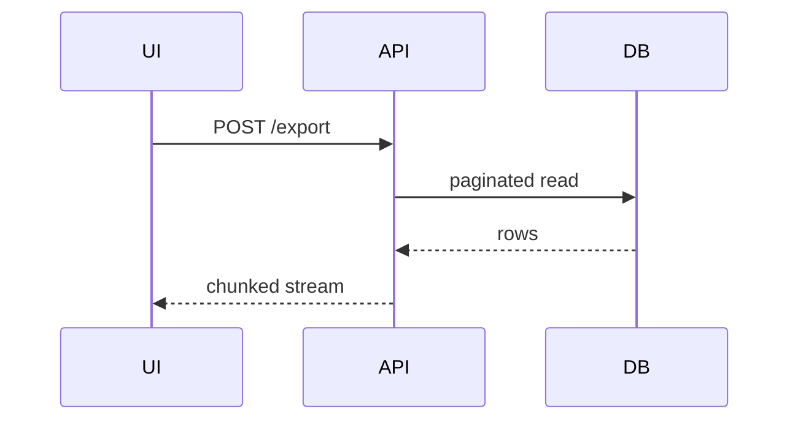

# Summary visual (under Summary prose)

Adapted from [mattpocock/skills — engineering/pr](https://github.com/mattpocock/skills/blob/main/skills/engineering/pr/SKILL.md).

## Role

Write Summary (or **Solution** on the default type) using the type guide. That prose stays the source of truth for what changed and why.

**Under** that paragraph, add the smallest visual that makes the main point obvious at a glance.

## Placement

Place each visual directly under the short text it supports. Include only the calls, files, props, states, and boundaries needed to answer *what changed*.

You may use one view or several when each answers a different question. You rarely need every option below. Use judgment; do not overwhelm the reader.

## Catalog

Pick one or more. Keep examples short in real PRs.

### Pseudocode (logic or algorithm)

```text
function retryWithBackoff(fn, maxAttempts):
  for attempt in 1..maxAttempts:
    try:
      return fn()
    except TransientError:
      sleep(baseDelay * 2^attempt)
  raise LastError
```

### Call tree (runtime control flow)

```text
POST /export
  └─ validateQuota(user)
  └─ buildCsvStream(rows)
       └─ paginate(query, pageSize=5000)
  └─ streamResponse(csv)
```

### Component tree (UI structure, state, module boundaries)

```text
ExportPage
  ├─ useExportJob()          // polling + error state
  ├─ ExportForm              // feature/export
  └─ DownloadBanner          // shows when job.status === "ready"
```

### Shallow file tree (ownership or broad refactor)

```text
src/export/
  ├── api.ts          # route + quota check
  ├── stream.ts       # pagination + CSV encoding
  └── ExportPage.tsx  # UI only
```

### Mermaid (interaction, control, or data flow)



### Diff (when the shape already exists)

Fence the block as `diff`, not `text`. On GitHub, a line that starts with `+` renders green and a line that starts with `-` renders red. Context lines start with a single space. Put `+` or `-` in column 1. A `text` fence will not color those lines. Leave comparison tables and brand-new trees as `text`.

**Component tree**

```diff
 ExportPage
-  └─ DownloadLink (single request)
+  ├─ useExportJob()
+  └─ DownloadBanner
```

**File layout**

```diff
 src/export/
+  stream.ts
   api.ts
-  bulkDownload.ts
```

**Call tree**

```diff
 POST /export
-  └─ readAllRows()
+  └─ paginate(query, pageSize=5000)
+       └─ streamResponse(csv)
```

**State / control flow**

```diff
- user clicks → single fetch → file
+ user clicks → job queued → poll → stream when ready
```

### Full block (new surface, missing context, or copyable target)

Use when most of the structure is new, omitting surrounding lines would hide ownership or order, or the reader needs a paste-ready shape.

```text
src/export/stream.ts   # new
  paginate(query, pageSize)
  encodeCsvRow(row)
  streamToResponse(iterator)
```

## Do not duplicate later diagrams

If **Architecture**, **Flow**, or **Fix** already includes a diagram, Summary (or **Solution**) gets the **smaller** view only.

Keep the later diagram when it answers a different question—for example ownership, the failing path, or where conditions fork—not the same picture twice.
