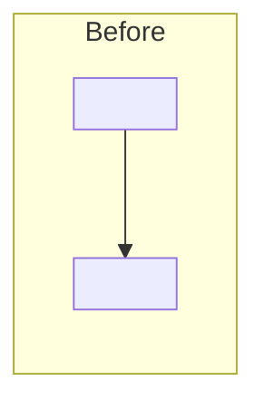
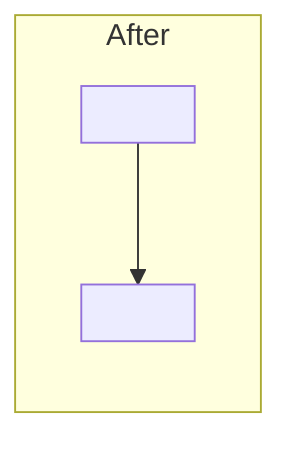

# <Defect name with clear action verb>

## Summary

<Observable failure>. <Corrected behavior after the fix>.

```diff
 <existing step>
-  <faulty behavior>
+  <corrected behavior>
```

Use a `diff` fence when the view is a change, so GitHub colors `+` and `-`. Use `text` for pseudocode that is not a change. See ../../shared/summary-view.md.

## Purpose

<Who is affected and impact>. <What this fix covers; what is out of scope>.

## Reproduction

Setup: <environment, data, config>.

1. <step>
2. <step>

Expected: <correct result>.
Actual: <broken result>.

## Root cause

<Component, trigger, and why existing logic failed.>

## Fix

<Behavioral change and owning component.>

(Omit mermaid when control flow is unchanged.)





## How to verify

```bash
<start services or run tests>
```

1. <reproduction with fixed result>
2. <focused regression check>

## Merge Danger

**Door:** one-way | two-way

<optional: stored data rewrite vs new-request-only logic>

**Blast radius:** <short phrase>

<optional: who or what breaks if this is wrong>
